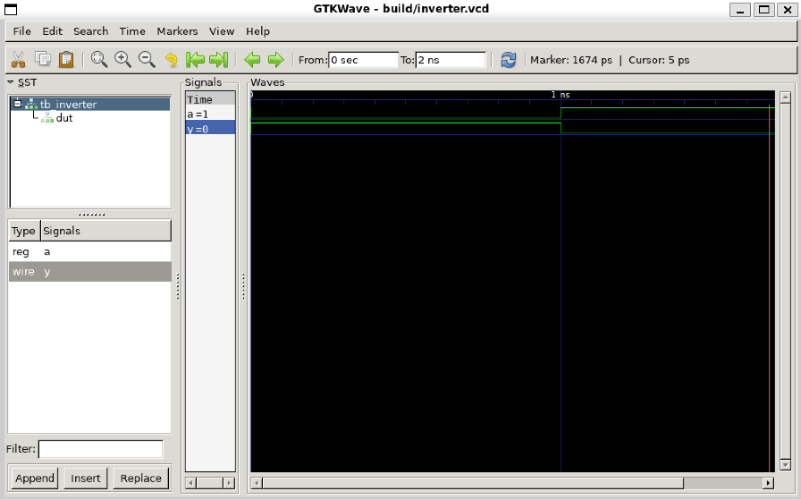

# Lab 01 ? Environment and GF180 tool check

Run commands in the Ubuntu app with Docker Desktop running. The Linux workspace is `~/ccen621/project10-neural-mac`. The original course files are in the Windows Project folder. The official template is at commit `e0d770f2c5683019858465324f6a4c36e94504db` and support tools at `8f7b5060d7f6df73bfd2e0b8d8fa0fd1dca0a0b1`.

## 1. Verify the host

```powershell
wsl -l -v
```

```bash
cat /etc/os-release
docker version
df -h ~ /mnt/c
free -h
sudo apt update
sudo apt install git make build-essential iverilog yosys gtkwave
```

An earlier installation also included `poppler-utils` for PDF inspection. Ubuntu supplies system Python 3.8. The Python tools below run in an isolated environment.

## 2. Re-create the baseline checkout and Python tools

These checkout commands are for a fresh machine. The working copy for this session already exists.

```bash
mkdir -p ~/ccen621
cd ~/ccen621
git clone https://github.com/TinyTapeout/ttgf-verilog-template project10-neural-mac
cd project10-neural-mac
git checkout e0d770f2c5683019858465324f6a4c36e94504db
git clone https://github.com/TinyTapeout/tt-support-tools tt
git -C tt checkout 8f7b5060d7f6df73bfd2e0b8d8fa0fd1dca0a0b1
curl -fsSL https://astral.sh/uv/install.sh -o ~/ccen621/install-uv.sh
env UV_NO_MODIFY_PATH=1 sh ~/ccen621/install-uv.sh
~/.local/bin/uv venv --python 3.12.16 ~/ccen621/tt-env
~/.local/bin/uv pip install --python ~/ccen621/tt-env/bin/python -r tt/requirements.txt librelane==3.0.14
```

LibreLane 3.0.14 matches the template's `ttgf26c` action default for GF180. The workflow lives in `.github/workflows/gds.yaml`.

## 3. Repeat the Lab 01 simulation and generic synthesis

```bash
cd ~/ccen621/project10-neural-mac
bash scripts/lab01.sh
gtkwave build/inverter.vcd
```

Select `tb_inverter` in GTKWave. Add `a` and `y` and use Zoom Fit. Mark the two intervals on the screenshot. Icarus checks both inverter inputs and all four AND inputs. Yosys checks each module and reports one generic cell per design. This verifies the truth tables and the basic synthesis path. Physical area requires a technology-mapped and placed design.

## 4. Repeat the GF180 template smoke test

Use the separate checkout at `~/ccen621/lab01-template`. Its title, author and description identify the smoke test. The RTL and physical configuration are the upstream template's.

```bash
cd ~/ccen621/lab01-template
source ~/ccen621/tt-env/bin/activate
export PDK=gf180mcuD PDK_ROOT="$HOME/ccen621/pdk" LIBRELANE_TAG=3.0.14
set -o pipefail
(
    set -ex
    date -Is
    python tt/tt_tool.py --pdk "$PDK" --create-user-config
    python tt/tt_tool.py --pdk "$PDK" --harden
    python tt/tt_tool.py --pdk "$PDK" --print-warnings
) 2>&1 | tee ~/ccen621/project10-neural-mac/logs/lab01_harden_template.txt
```

Review `logs/setup_versions.txt`, `logs/lab01_sim.txt`, `logs/lab01_yosys.txt` and the template flow log. The course asks for the sources, commands, timestamped outputs, one annotated image and a design assessment. Instructor review is the grading checkpoint.

## Waveform evidence



At the left of the 1 ns grid line, the upper trace is the input `a=0` and the lower trace is the output `y=1`. At that grid line the input rises and the output falls. The marker to the right reads `a=1, y=0`. The transition is instantaneous in the zero-delay RTL model.

## GF180 technology mapping

```bash
cd ~/ccen621/project10-neural-mac
bash scripts/lab01-map.sh
```

The script locates the Liberty and LEF views under the installed `gf180mcuD/libs.ref/gf180mcu_fd_sc_mcu7t5v0` directory. Liberty describes cell timing and area. LEF describes geometry and pin locations used by physical design. The selected library corner is typical process, 25 ?C, 3.30 V. The PDK revision is `54435919abffb937387ec956209f9cf5fd2dfbee`.

Both truth-table simulations passed. Generic synthesis returned one NOT cell and one AND cell in their respective modules. Technology mapping returned one GF180 inverter with 8.7808 ?m? of library cell area and one GF180 AND cell with 17.5616 ?m?. These measurements describe individual standard cells before placement. The template physical smoke test uses its 20 ns clock and its configured set of timing corners.

## Template smoke-test result

LibreLane completed the Classic flow and wrote `~/ccen621/lab01-template/runs/wokwi/final/gds/tt_um_example.gds`. The template RTL computes the combinational sum of `ui_in` and `uio_in`. The smoke-test description called it a counter, but the baseline source contains an adder and leaves `clk` unused. The flow reported zero clock sinks and setup violations at slow 125 ?C, 3.00 V corners. KLayout DRC was disabled by the template configuration. These observations scope the environment check to successful tool execution through GDS generation. Preserve the log and metrics for review.

The first config attempt in the project checkout hit the template's blank title, author and description. The separate smoke-test checkout supplied those fields while retaining the exact baseline RTL. Its successful log is `logs/lab01_harden_template.txt`.
